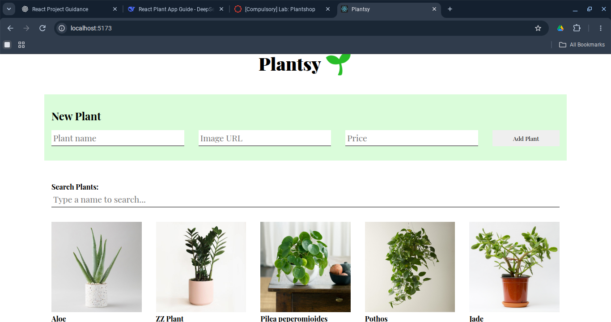

# Plantsy

A React application for managing a plant shop. Users can view plants, add new plants, search for plants, and mark them as sold out.

## Features
- **View Plants:** Fetches and displays a list of plants from a local server on page load.
- **Add a Plant:** Submit a form to add a new plant to the shop.
- **Search:** Filter the plants by name using the search bar.
- **Mark Sold Out:** Click a button to mark a plant as out of stock (non-persisting).

## How to Run
1. Clone the repository.
2. Install dependencies: `npm install`
3. Start the backend server: `npm run server`
4. Start the React app: `npm run dev`
5. Open your browser to the local host link provided in the terminal (usually `http://localhost:5173`).

## Screenshot
